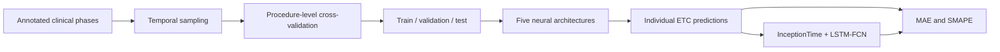

<div align="center">

# Clinical Procedure Duration Prediction

**Deep learning for phase-based estimation of the time remaining in coronary angiography procedures**

[](https://doi.org/10.1080/24699322.2025.2466426)
[](https://doi.org/10.1080/24699322.2025.2466426)
[](https://github.com/emanuelefrassini/prediction_procedure_duration/actions/workflows/repository-checks.yml)


[**Publication**](https://doi.org/10.1080/24699322.2025.2466426) · [**Methods**](docs/methods.md) · [**Setup & execution**](docs/reproducibility.md) · [**Outputs & analysis**](docs/results.md)

</div>

---

## Overview

This repository contains the TensorFlow/Keras research code and anonymized numerical data accompanying:

**Frassini, E., Vijfvinkel, T. S., Butler, R. M., van der Elst, M., Hendriks, B. H. W., & van den Dobbelsteen, J. J. (2025).** *Deep learning methods for clinical workflow phase-based prediction of procedure duration: a benchmark study.* Computer Assisted Surgery, 30(1), 2466426. [doi:10.1080/24699322.2025.2466426](https://doi.org/10.1080/24699322.2025.2466426).

The study investigates the **estimated time to completion (ETC)** of coronary angiography procedures using the sequence of manually annotated clinical phases. Models receive *phase sequences*, not raw video frames.

| 222 procedures | 14 workflow phases | 5 model families + ensemble | 5 sampling intervals |
|:---:|:---:|:---:|:---:|
| Anonymized phase/target arrays | Time-series regression | LSTM · Attention · LSTM-FCN · Transformer · InceptionTime | 5 · 10 · 30 · 60 · 120 s |

## Experimental workflow



The primary entry point is **[`models/PAPER_ETC.py`](models/PAPER_ETC.py)**. It retains the model definitions from [`utils/models.py`](utils/models.py) and uses [`utils/paper_training.py`](utils/paper_training.py) for validation separation, padding aware SMAPE, and training. The experiment is configured for **100 repeated trials**, **three outer folds**, and up to **1,000 epochs**. Details and the model settings are in the [methods guide](docs/methods.md).

## Results in the publication

The values below are **reported in Table 2 of the published paper** for one phase observation every 60 seconds. 

| Model | MAE (min) ↓ | SMAPE (%) ↓ |
|:---|---:|---:|
| **InceptionTime** | **0.53 ± 0.09** | **5.8 ± 1.2** |
| LSTM-FCN | 2.35 ± 0.92 | 12.3 ± 5.3 |
| Ensemble (InceptionTime + LSTM-FCN) | 1.32 ± 0.76 | 7.2 ± 1.9 |
| Transformer | 7.13 ± 2.31 | 19.3 ± 8.2 |
| LSTM | 12.06 ± 2.44 | 44.5 ± 19.3 |
| LSTM with attention | 17.33 ± 3.54 | 75.6 ± 21.1 |


*The visualization uses published aggregate results. This is a retrospective, single-center research study, not a clinically validated deployment.*

## Get started

Use **Python 3.10** with **TensorFlow 2.10** for model training. The quick checks below use only NumPy and the standard library.

```bash
# From the repository root
python -m pip install -r requirements-validation.txt
python -m unittest discover -s tests -p 'test_*.py' -v
python scripts/check_experiment.py
```

To inspect the available numerical dataset without printing individual observations:

```bash
python scripts/inspect_dataset.py --data-dir data
```

To run the experiment in a dedicated Python 3.10 environment:

```bash
python -m pip install -r requirements-legacy-py310.txt
python -m models.PAPER_ETC
```

**Compute note:** the full configuration comprises 100 trials × 3 folds × 5 sampling intervals × 5 trained architectures. For a limited integration run, the existing runner supports environment overrides:

```bash
ETC_TRIALS=1 ETC_EPOCHS=1 ETC_INTERVALS=120 python -m models.PAPER_ETC
```

This short run exercises the code, but **one epoch does not provide a meaningful performance comparison**. See [experiment setup](docs/reproducibility.md) for environment requirements, dataset paths, and evaluation conventions.

## Repository map

```text
prediction_procedure_duration/
├── data/                   Anonymized phase and remaining-time CSV arrays
├── models/                 Main study experiment and architecture-specific scripts
│   └── PAPER_ETC.py        Primary five-model benchmark runner
├── utils/                  Keras model factories, preprocessing and training helpers
├── tools/                  Original exploratory result-processing and plotting scripts
├── scripts/                Dataset inspection, experiment checks and result summaries
├── tests/                  Lightweight numerical and repository checks
├── figures/                Figure reconstructed from published aggregate metrics
├── docs/                   Methods, environment, output format and limitations
├── CITATION.cff            Machine-readable publication citation
└── requirements*.txt       Training and validation environments
```

**Navigation:** [Model scripts](models/README.md) · [Analysis tools](tools/README.md) · [Data format](data/README.md) · [Result files](docs/results.md)

## Summarizing a completed run

The main experiment retains its original `models/runs/` output layout. A standard-library summary utility can aggregate **completed fold-level score files**, without loading the dataset:

```bash
python scripts/summarize_results.py models/runs/runs_PAPER_YYYYMMDD-HHMMSS
python scripts/summarize_results.py models/runs/runs_PAPER_YYYYMMDD-HHMMSS --format csv
```

The utility reports the number of completed folds. Incomplete runs are not silently presented as full 100-trial results. See [outputs & analysis](docs/results.md). The original scripts in `tools/` are retained separately for historical analyses and plots.

## Scope and citation

The public data files are anonymized procedure-level sequences. `X.csv` and `Y.csv` are not raw videos. 
The definitions of the architecture deliberately retain the research implementation, including non-causal convolution/pooling operations in some networks. A real-time, strictly causal system would require separate evaluation. Please cite the [published article](https://doi.org/10.1080/24699322.2025.2466426) when reusing the work; citation metadata are provided in [`CITATION.cff`](CITATION.cff).
