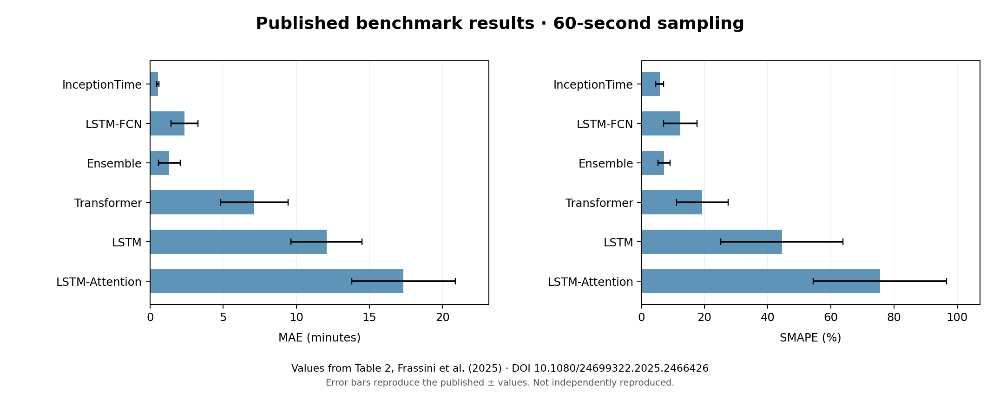

# Phase-Based Prediction of Clinical Procedure Duration

**Research code for the peer-reviewed benchmark of deep-learning models that estimate the remaining time to completion (ETC) of coronary angiography procedures from clinical workflow phases.**

[**Read the paper**](https://doi.org/10.1080/24699322.2025.2466426) · [**Reproducibility guide**](docs/reproducibility.md) · [**Research code audit**](docs/research-code-audit.md)

> **Scope and status.** This repository contains historical TensorFlow/Keras research scripts and numerical phase/target CSVs, plus lightweight validation utilities. The published results below are **reported from the paper, not a reproduction** by the added tests. This is research software, **not** a validated clinical decision-support system.

## Scientific motivation

For a procedure in a cardiac catheterization laboratory, estimating the expected time to completion can help coordinate downstream scheduling. This benchmark evaluates how well a one-dimensional sequence of **manually annotated clinical workflow phases** predicts the remaining time until the end of a diagnostic coronary angiography (CAG) procedure. The models are not trained on raw video pixels; annotations were derived from video review.

The study used **222 procedures**, **14 clinical phases**, and compared **LSTM, LSTM-Attention, Transformer, LSTM-FCN, InceptionTime, and an ensemble**. Temporal sampling intervals of **5, 10, 30, 60, and 120 seconds** were investigated using repeated three-fold evaluation. See the [published paper](https://doi.org/10.1080/24699322.2025.2466426) for the exact experimental methods and limitations.

## Results reported in the paper

The following are the **published Table 2 values** at one input sample every **60 seconds** (mean ± reported deviation across experimental trials). Units and model labels follow the article.

| Model | MAE (minutes) | SMAPE (%) |
|---|---:|---:|
| **InceptionTime** | **0.53 ± 0.09** | **5.8 ± 1.2** |
| LSTM | 12.06 ± 2.44 | 44.5 ± 19.3 |
| LSTM-FCN | 2.35 ± 0.92 | 12.3 ± 5.3 |
| Transformer | 7.13 ± 2.31 | 19.3 ± 8.2 |
| LSTM-Attention | 17.33 ± 3.54 | 75.6 ± 21.1 |
| Ensemble (InceptionTime + LSTM-FCN) | 1.32 ± 0.76 | 7.2 ± 1.9 |



*Visualization recreated from the published aggregate values, not from raw clinical data or an independent training run. Error bars correspond to the values given after ± in Table 2.*

**Takeaway:** InceptionTime performed best in the reported 60-second sampling benchmark, whereas the Transformer had the lowest reported inference time. The paper also evaluates error at 5, 10, 15 and 20 minutes before completion. Avoid generalizing these single-center results to deployment without independent clinical validation.

## Repository layout

| Path | Role |
|---|---|
| `models/` | Historical Keras/TensorFlow model experiments, including `PAPER_ETC.py` and model-specific runs |
| `utils/` | Original shared preprocessing, attention and training code |
| `tools/` | Original analysis, plotting and ensemble scripts |
| `data/X.csv`, `data/Y.csv` | Existing tracked procedure-derived phase/target data; **review sharing authorization** |
| `phase_etc/` | Added NumPy-only metrics and deterministic procedure-level train/validation/test split helpers |
| `scripts/smoke_etc.py` | Data-free synthetic validation |
| `scripts/inspect_dataset.py` | Optional local CSV shape/padding inspection (no raw rows printed) |
| `scripts/optional_fix_legacy_paths.py` | Guarded opt-in portability patch; backs up original code |
| `tests/` | Lightweight unit and integrity tests, independent of TensorFlow and clinical data |
| `docs/` | Reproducibility conditions, limitations and audit of code/paper mismatches |
| `.github/workflows/repository-checks.yml` | Automated checks on Python 3.10 and 3.12 |

## Quick start: verify the research utilities

A lightweight environment is recommended for documentation and metric testing. **No clinical data, TensorFlow or GPU are required** for these checks.

```bash
python3 -m venv .venv
source .venv/bin/activate
python -m pip install -r requirements-validation.txt
python -m unittest discover -s tests -p 'test_*.py' -v
python scripts/smoke_etc.py
```

Example output ends with:

```text
Synthetic ETC smoke test PASSED (not a reproduction of the clinical benchmark).
```

The synthetic smoke test checks shapes, remaining-time metric conventions, padding and data partitioning; it **does not validate model performance or the article's published MAE values**.

### Local dataset inspection (optional)

```bash
python scripts/inspect_dataset.py --data-dir data
```

This checks numeric CSV dimensions, alignment, and missing/padded values without printing procedure-level observations. The original training scripts expect two numeric arrays reshaped to `(222, 7573, 1)` and use `-1` as a padding marker. Only use data you are authorized to access and redistribute.

### Historical training code

The original study reports TensorFlow **2.10.0**, but `requirements.txt` is not a historical lockfile. Several scripts also require path/import fixes and historical Keras behavior. The limited path/import patch can be previewed with:

```bash
python scripts/optional_fix_legacy_paths.py --check
```

To opt in, review `docs/reproducibility.md` before running `--apply`. **Do not launch the full historical experiments assuming they reproduce the paper unchanged:** the checked-in ensemble, trial range, validation handling and model loss need reconciliation with the publication. Details are in [the audit](docs/research-code-audit.md).

## Data governance and limitations

The `data/X.csv` and `data/Y.csv` files are **already tracked in the public Git repository**. Please verify that redistribution of these procedure-derived data is authorized. The new `.gitignore` prevents accidental *future* additions of similar files; it does **not** remove files or their earlier versions from Git history. No clinical data are included in the synthetic examples or test output. The paper is open-access under CC BY 4.0; this does **not** automatically license the repository's software or data.

This is a single-center, retrospective phase-based benchmark with manually annotated workflows. External clinical validation, real-time automated phase recognition, and robustness to partial procedures are outside the scope of the released checks.

## Citation

Frassini, E., Vijfvinkel, T. S., Butler, R. M., van der Elst, M., Hendriks, B. H. W., & van den Dobbelsteen, J. J. (2025). **Deep learning methods for clinical workflow phase-based prediction of procedure duration: a benchmark study.** *Computer Assisted Surgery, 30*(1), 2466426. https://doi.org/10.1080/24699322.2025.2466426

GitHub users can also use the repository's `CITATION.cff` file for machine-readable citation metadata.

## Research note

Code and metrics are provided for research and educational analysis. Use of predictions to schedule clinical care would require additional validation, oversight, and deployment safeguards. Questions about authorization or clinical-data sharing should be resolved with the relevant dataset owner/institution before further redistribution.
